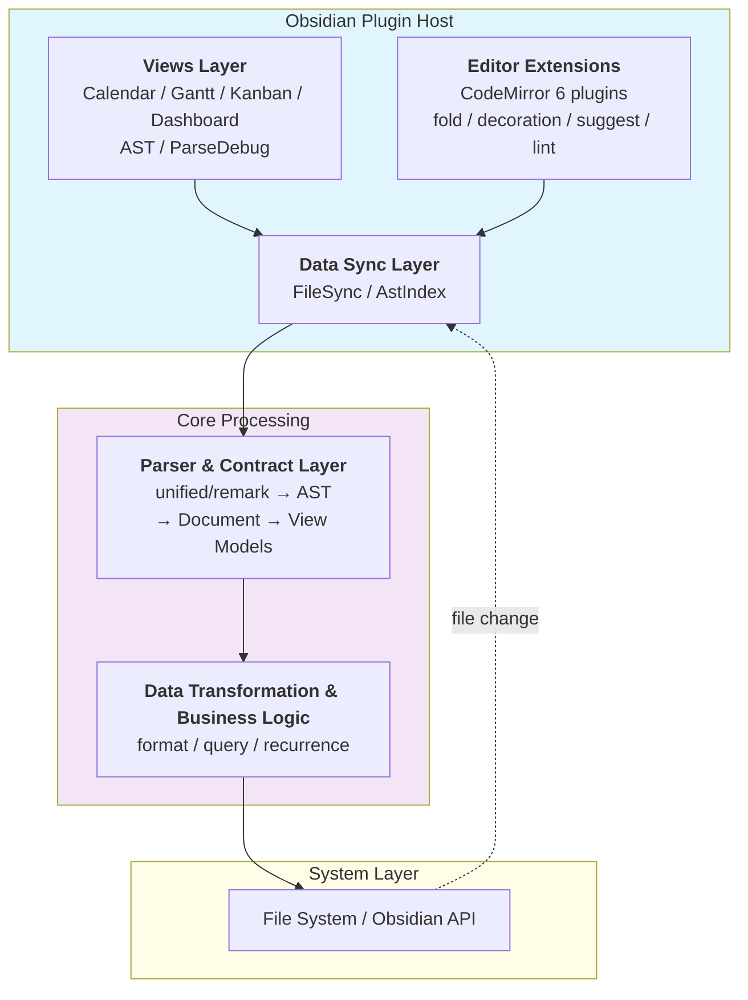
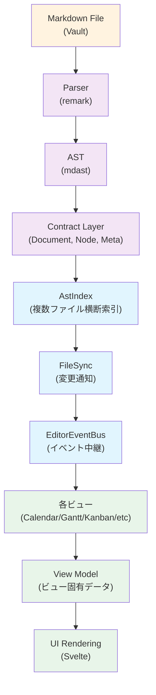
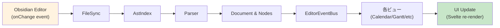
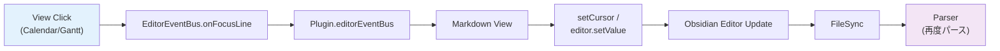
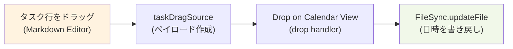

# アーキテクチャ設計

## 全体構成

MD AST Editorは以下の主要なレイヤーから構成されています：



## 責務分離

### Plugin Core (`src/plugin.ts`)

- Obsidianプラグインとしてのライフサイクル管理
- ビュー・エディタ拡張・コマンドの登録
- 設定ハブ（ViewSettingsHub）の初期化
- エディタイベントバスの管理

**主要コンポーネント**:
- `MdAstEditorPlugin` - メインクラス
- `FileSync` - ファイル同期
- `AstIndex` - AST索引化
- `EditorEventBus` - イベント中継

### 設定管理 (`src/settings.ts`)

- プラグイン設定の定義・バリデーション
- レガシー設定のマイグレーション
- Obsidian設定パネルのUI

**設定項目**:
- メタキーのユーザー別名
- デバウンス時間
- インデックススコープ
- ビュー別の設定オブジェクト

### ビュー層 (`src/views/`)

複数のビューが各々の表現でMarkdownデータを可視化・操作します。

#### ビュータイプの対応関係

| ビュー | 役割 | マウント方式 |
|--------|------|-----------|
| Calendar | 日付ベースのスケジュール表示 | Svelte (CalendarViewMount) |
| Gantt | スケジュール・依存関係の可視化 | Svelte (GanttViewMount) |
| Kanban | ステータス列による進捗管理 | Svelte (KanbanViewMount) |
| Dashboard | メトリクス・統計の表示 | Svelte (DashboardViewMount) |
| AST | 解析結果のツリー表示（開発者向け） | Svelte (AstViewMount) |
| ParseDebug | パーサーの動作確認（開発者向け） | Svelte (ParseDebugViewMount) |

**ビュー基盤**:
- `ShadowItemView` - Shadow DOM を使用した基盤クラス
- Svelte コンポーネントを Shadow DOM にマウント
- `FileSync` と `EditorEventBus` を通じてデータ受信

#### ビュー間のデータフロー



### エディタ拡張層 (`src/editor/`)

CodeMirror 6 プラグインとしてエディタの機能を拡張します：

| モジュール | 機能 |
|----------|------|
| `meta-fold` | メタ情報の折りたたみ・展開 |
| `metatag-decoration` | メタ情報のシンタックスハイライト |
| `metatag-picker` | 日付ピッカー UI |
| `metatag-suggest` | オートコンプリート |
| `notation-lint` | 記法のバリデーション |
| `task-decoration` | タスク行の装飾 |
| `task-drag-source` | ドラッグ&ドロップペイロード |
| `repeat-picker` | 繰り返しスケジュール入力 UI |

### 同期層 (`src/sync/`)

**FileSync** (`src/sync/file-sync.ts`):
- 現在のアクティブなMarkdownファイルを追跡
- ファイルの変更をデバウンス処理で検知
- 変更内容を各ビューに通知

**AstIndex** (`src/sync/ast-index.ts`):
- 複数ファイル横断のAST索引を管理
- 索引化スコープ（Vault全体 / フォルダ指定）を制御
- 検索・クエリ処理をサポート

### パーサー層 (`src/lib/parser/`)

Markdown テキストを AST（mdast）に変換し、MD AST Editor 固有の `Document` 構造に映射します。

**処理の流れ**:

1. **Markdown テキスト入力** → remark でパース（mdast を生成）
2. **メタフィールド抽出** → `remark-meta-fields` プラグインがメタ行を解析
3. **Contract 層への映射** → `Document`, `Section`, `Node`, `Meta` オブジェクトを構築
4. **ビュー投影** → 各ビュー用の `ViewModel` にデータを変換

**主要モジュール**:

| モジュール | 役割 |
|----------|------|
| `meta-keys.ts` | メタキーの標準名・別名管理 |
| `plugins/remark-meta-fields.ts` | メタ行の抽出・パース |
| `plugins/...` | その他のremark拡張プラグイン |

### Contract 層 (`src/lib/contract/`)

Parser の出力と ViewModel の入力をつなぐ中間層。Markdown 解析結果を標準化されたデータ構造にマッピング。

```typescript
// Document 構造
Document {
  sections: Section[]    // 見出しごと
  nodes: Node[]          // リスト・引用
  meta: Meta             // 文書全体のメタ
}

// Node（タスク・リスト・引用）
Node {
  type: 'task' | 'list' | 'quote'
  text: string
  status: TaskStatus  // [?], [ ], [>], [!], [/], [-], [x]
  meta: Meta
  children: Node[]
}

// Meta（メタ情報）
Meta {
  schedule?: TimeRange
  plan?: DateRange
  due?: Date
  priority?: number
  tags?: string[]
  // ... その他キー
}
```

### ビジネスロジック層

**Query Engine** (`src/lib/query/`):
- Document から条件に合致するノードを検索
- ビューでのフィルタリング実装

**Recurrence** (`src/lib/recurrence/`):
- `@repeat` （iCalendar RRULE）の解釈
- 繰り返しスケジュール の展開

**Format & Viewmodel** (`src/lib/format/`, `src/lib/viewmodel/`):
- 表示用フォーマット変換
- ビュー固有のデータ構造生成

## データフロー

### 編集フロー（ユーザーがエディタで編集）



### ビュー → エディタ フロー（ビューからファイルを編集）



### ドラッグ&ドロップ フロー



## 設計上の制約

### メタ情報の重複定義問題

メタ行の解釈が複数ファイルに重複して実装されているため、新しいメタキー追加時には5ファイルすべての更新が必要。

詳細と対応方法は [meta-key-guide.md](./meta-key-guide.md) を参照。

### Shadow DOM の使用

ビューは Shadow DOM で隔離されるため：
- 外部CSSの影響を受けない
- Obsidian のテーマを個別に適用可能
- 一部の Obsidian API に制限あり（例: `MarkdownPreviewView` は使用不可）

### ファイル監視の遅延

ファイル変更から各ビューへの反映までに debounce 遅延があります（デフォルト 300ms）。
大規模ファイルの解析時にはさらに遅延する可能性があります。

## 外部依存

### Node パッケージ

**必須**:
- `unified` - AST処理フレームワーク
- `remark-parse` - Markdownパーサー
- `remark-gfm` - GitHub Flavored Markdown対応
- `mdast-util-to-string` - AST→テキスト変換
- `luxon` - 日時処理
- `rrule` - 繰り返しスケジュール計算

**UI/ビルド**:
- `svelte` - UIフレームワーク
- `monaco-editor` - エディタ（開発時の検証用）
- `@codemirror/*` - CodeMirror 6拡張
- `esbuild` - バンドラ

**テスト**:
- `vitest` - ユニットテスト
- `playwright` - ブラウザテスト
- `wdio-*` - Obsidianテスト

### Obsidian API

- `Plugin` - プラグインベース
- `ItemView` - カスタムビュー
- `MarkdownView` - Markdownエディタアクセス
- `Vault` / `TFolder` / `TFile` - ファイルシステムAPI
- `App` / `Workspace` - アプリケーションレベルAPI

## パフォーマンス最適化

- **デバウンス処理**: ファイル変更検知の遅延（300ms デフォルト）
- **インデックス化**: 複数ファイル解析結果のキャッシュ
- **遅延レンダリング**: ビューの必要な部分のみ初期表示
- **メモ化**: 計算結果のキャッシュ

## 今後の拡張可能性

- **新しいビューの追加**: `ShadowItemView` を継承するだけで実装可能
- **パーサープラグイン**: remark プラグイン形式で記法拡張可能
- **外部データソース連携**: FileSync を模したアダプタで複数ソース対応可能
